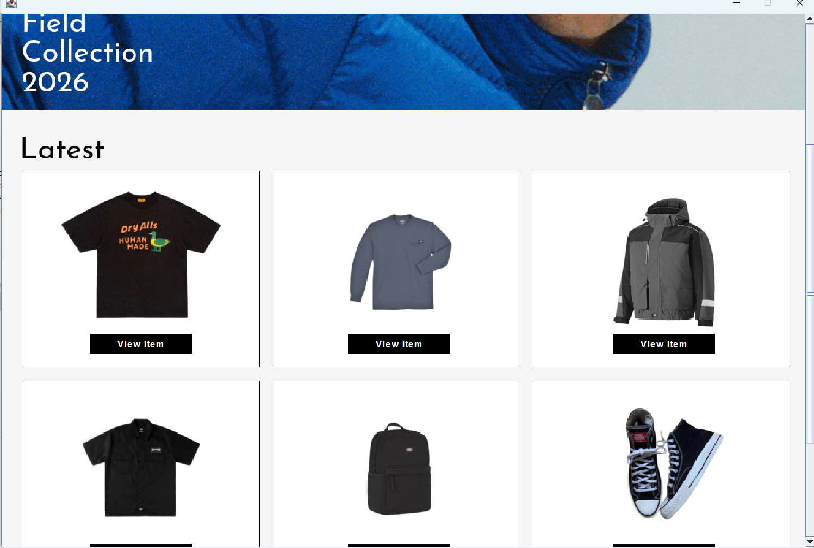

# Sir Talha Aday Serad

**Fresh BSIT Graduate • Aspiring Software Developer**

I'm a recent Information Technology graduate who learns software development by building things — academic projects first, then personal practice. I'm not claiming seniority or years of production experience. What I bring is consistency: finishing projects, debugging them honestly, and improving them over time.

If you're looking for an entry-level developer who is serious about learning and building actual software, I'd be glad to talk.

---

## 👋 Who Am I?

Fresh BSIT Graduate seeking entry-level Software Developer / Junior Developer roles.

**Developer mindset:** Critical thinking · Helpful · Perseverance · Continuous learning

---

## 🛠 Technologies I've Worked With

Everything below is **beginner / entry-level**. This is what I've worked with in school and personal practice — not a claim of mastery.

### Languages

| | |
|---|---|
|  |  |
|  |  |
|  |  |
|  | |

### Tools & Environments

**Focus areas:** Windows Forms desktop applications · Object-oriented programming · Front-end web · UI/UX & prototyping · Git/GitHub workflow

---

## 📂 Featured Projects

### 01 — Enrollment System
**C# · Windows Forms · Visual Studio 2026 · Desktop Application**

A C# Windows Forms enrollment system developed as an academic project, featuring interfaces and workflows for administrative, student and faculty-related functions — login and sign-up, administration, student and faculty management, student and faculty profiles, attendance, and grade entry.

*Positioned as an academic project demonstrating C# application development. Feature list is based on the project files provided and still needs a pass against the source before being treated as final.*

`[ ADD REPOSITORY ]` · `[ ADD SCREENSHOTS ]`

### 02 — BuildHub
**Java · Object-Oriented Programming · Academic Project**

A Java academic project focused on applying object-oriented principles to a practical problem. Project documentation and certificates are available through the linked reference.

> Specific OOP concepts are **not** listed here until the actual Java source is reviewed — I don't want to claim concepts the code doesn't demonstrate.

`[ ADD REPOSITORY ]` · [Documentation / Certificates](https://www.facebook.com/share/v/1bcAre6dq7/)

### 03 — Burger Shope
**Figma · UI/UX Design · Mobile Application Prototype**

A mobile burger shop application concept and prototype, built around an existing ordering and delivery setup. The project focuses on mobile interaction, burger shop user controls, delivery interaction, and overall mobile UI/UX.

**This is a design prototype, not a commercially released application.**

**Skills demonstrated:** Figma · UI/UX design · Mobile interface design · Prototyping · User interaction design · Product concept development

**→ [View Figma Prototype](https://www.figma.com/design/xhkCxEpu5nSQWSDOH6XD37/Untitled?m=auto&t=CRGHAEnz6q1LTTqI-6)**

### 04 — Mischief Shope
**Java · Programming Project**

A Java programming project. Feature-level detail is currently **pending verification against the actual Java source files** and will be completed once the code is available rather than guessed.

| Screenshot |
|:-:|
|  |

`[NEEDS VERIFICATION]` · `[ ADD REPOSITORY ]`

---

## 📁 Other Repositories

| Repository | Language | Contents |
|---|---|---|
| [TalhaSerad](https://github.com/Dar200424/TalhaSerad) | CSS | `main.html`, `main.css`, `img.jpg` — HTML/CSS layout project |
| [Loving](https://github.com/Dar200424/Loving) | HTML | `loveletter.html` |

---

## 📚 Currently Learning

- **Programming fundamentals** — control flow, functions, arrays, problem solving before complexity
- **C# & application development** — deeper Windows Forms, event-driven design, larger app structure
- **Java & OOP** — applying classes, encapsulation, inheritance and abstraction to real projects
- **C++** — memory, pointers, more structured program design
- **PHP** — server-side basics and working with data submitted from a form
- **Web development** — responsive front-end practice and DOM handling, applied in personal projects
- **Building practical applications** — projects with real inputs and real calculations, not only exercises
- **Clean and maintainable code** — naming, structure, and code that someone else can follow
- **Git / GitHub workflow** — branching, clean commit history, reviewable repositories
- **Project documentation** — honest READMEs: what it does, how to run it, what I actually learned

---

## 🧠 Developer Mindset

I see software development as a loop, not a line:

**Learn → Build → Break → Fix → Improve**

You learn something, build with it, get it wrong, figure out why, and try again. That cycle is the actual work. Perseverance matters more than speed — most of what I know about programming, I know because something didn't work and I stayed with it until it did.

---

## 🔗 Links

| | |
|---|---|
| **GitHub** | [github.com/Dar200424](https://github.com/Dar200424) |
| **Email** | [talha_serad@sjp2cd.edu.ph](mailto:talha_serad@sjp2cd.edu.ph) |
| **Phone** | 0993 371 4406 |
| **Figma (Burger Shope)** | [Open prototype](https://www.figma.com/design/xhkCxEpu5nSQWSDOH6XD37/Untitled?m=auto&t=CRGHAEnz6q1LTTqI-6) |
| **BuildHub documentation** | [Certificates & docs](https://www.facebook.com/share/v/1bcAre6dq7/) |
| **LinkedIn** | `[ ADD LATER ]` |
| **Personal portfolio site** | `[ ADD LATER ]` |

---

## 📬 Open To

Entry-level Software Developer · Junior Developer · Software Engineer (new grad) · IT Developer roles

---

## 📄 Note On This README

Placeholder markers like `[ ADD REPOSITORY ]` and `[NEEDS VERIFICATION]` are intentional. I don't publish links, features or technologies I can't back up with real source code or real materials. Those get replaced as the actual repositories and screenshots are finalised.

---

**Made with HTML, CSS, JavaScript, and honesty.**